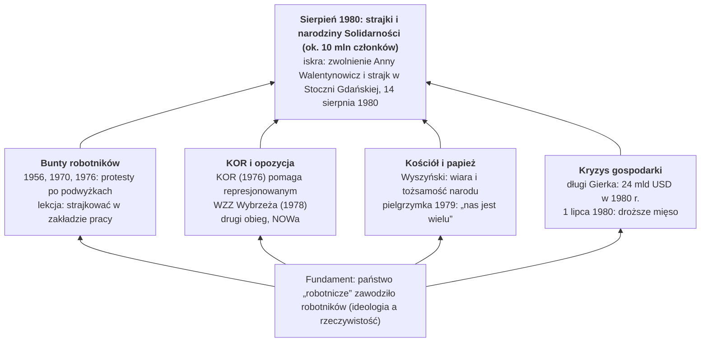
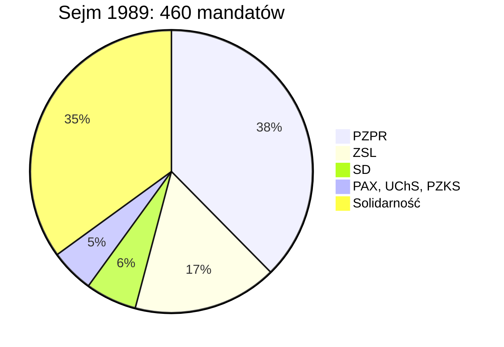

# Polska w czasach komunizmu – A-level Polish revision

> Część 3 z 5 (ciąg dalszy)

## 3. Solidarność · The Solidarity movement

NSZZ „Solidarność” (wrzesień 1980) był pierwszym niezależnym związkiem zawodowym w bloku sowieckim i masowym ruchem społecznym: jesienią 1981 r. miał ok. 9,5–10 mln członków, czyli mniej więcej co trzeciego dorosłego Polaka. Po dziewięciu latach walki doprowadził do Okrągłego Stołu, wyborów 4 czerwca 1989 r. i pierwszego niekomunistycznego rządu w bloku.

### Geneza: skąd się wzięła Solidarność?

**Solidarność wyrosła z czterech źródeł naraz.**

*Przyczyny powstania Solidarności · cztery źródła i iskra.*

Żadne źródło samo nie wystarczyło: robotnicy mieli siłę, opozycja organizację, Kościół wartości, a kryzys dał powód. To dobry szkielet odpowiedzi na pytanie o genezę (jak w 2020 r.).

| Rok | Wydarzenie | Lekcja dla opozycji |
| --- | --- | --- |
| 1956 | Poznański Czerwiec, ok. 58 zabitych | robotnicy potrafią się zbuntować, ale władza strzela |
| 1968 | Marzec: protesty studentów, antysemicka nagonka, emigracja ok. 13 tys. osób pochodzenia żydowskiego | inteligencja sama przegrywa: robotnicy nie poparli studentów |
| 1970 | Grudzień na Wybrzeżu: podwyżki cen przed świętami, 45 zabitych i 1165 rannych; Gomułkę zastępuje Gierek | wyjście na ulicę kończy się śmiercią, lepszy jest strajk okupacyjny w zakładzie |
| 1976 | Czerwiec: Radom, Ursus, Płock; podwyżki cofnięte, ale robotników bito i zwalniano. 23 września powstaje KOR (m.in. Jacek Kuroń, Adam Michnik) | inteligencja i robotnicy łączą siły |
| 1977–1980 | ROPCiO, KPN, Wolne Związki Zawodowe Wybrzeża (1978: Bogdan Borusewicz, Andrzej Gwiazda, Anna Walentynowicz, Lech Wałęsa), drugi obieg, Uniwersytet Latający | powstaje sieć ludzi gotowych pokierować strajkiem |
| 1978–1979 | papież Polak i pielgrzymka do ojczyzny | poczucie wspólnoty i odwagi |

Hasło Kuronia brzmiało: „Nie palcie komitetów, zakładajcie własne”. To istota strategii: zamiast walczyć z państwem na ulicy, budować niezależne społeczeństwo obywatelskie.

### Sierpień 1980

1. **1 lipca 1980** – podwyżki cen mięsa i wędlin; w lipcu strajkuje m.in. Lubelszczyzna.
2. **14 sierpnia** – strajk w Stoczni Gdańskiej im. Lenina w obronie zwolnionej suwnicowej Anny Walentynowicz. Na czele staje elektryk Lech Wałęsa.
3. **16 sierpnia** – dyrekcja spełnia żądania stoczniowców, ale strajk trwa dalej jako strajk solidarnościowy z innymi zakładami. W nocy z 16 na 17 sierpnia powstaje **MKS** (Międzyzakładowy Komitet Strajkowy); do końca sierpnia uznało go ok. 700 zakładów.
4. **21 postulatów MKS**, spisanych na tablicach i zawieszonych na bramie stoczni (od 2003 r. na liście UNESCO Pamięć Świata). Najważniejszy, nr 1: wolne związki zawodowe niezależne od partii i pracodawców.
5. **30 sierpnia** porozumienie w Szczecinie, **31 sierpnia** w Gdańsku (Wałęsa i wicepremier Mieczysław Jagielski, transmisja w telewizji), **3 września** w Jastrzębiu. 6 września Gierka zastępuje Stanisław Kania.

| Rodzaj postulatów | Przykłady |
| --- | --- |
| polityczne | wolne związki zawodowe i prawo do strajku; wolność słowa i ograniczenie cenzury; uwolnienie więźniów politycznych; dostęp Kościoła do radia (msza niedzielna); prawdziwa informacja o gospodarce |
| ekonomiczne i socjalne | podwyżki płac; zaopatrzenie sklepów; kartki na mięso (nr 11); likwidacja sprzedaży za dewizy; zniesienie przywilejów MO, SB i aparatu partyjnego; krótsze czekanie na mieszkanie; żłobki i przedszkola; wolne soboty (nr 21) |

**Dlaczego w 1980 r. się udało?** Strajk okupacyjny zamiast demonstracji, zakaz alkoholu, dyscyplina, msze w stoczni, wsparcie ekspertów (m.in. Tadeusz Mazowiecki i Bronisław Geremek) i jedność wielu zakładów. Cena kompromisu: Solidarność uznała kierowniczą rolę PZPR i sojusze Polski.

### „Karnawał Solidarności” (sierpień 1980 – grudzień 1981)

- **17 września 1980** – delegaci z całego kraju tworzą jeden ogólnopolski związek; nazwę „Solidarność” zaproponował Karol Modzelewski. **10 listopada 1980** – rejestracja w sądzie.
- Do związku wstąpił także ok. milion członków PZPR. Powstają też Solidarność Rolników Indywidualnych i Niezależne Zrzeszenie Studentów.
- Odwilż w życiu codziennym: *Tygodnik Solidarność* (red. Tadeusz Mazowiecki), mniej cenzury, pomnik Poległych Stoczniowców 1970 w Gdańsku (grudzień 1980), wolne soboty.
- Napięcia: kryzys bydgoski (marzec 1981, pobicie działaczy), manewry wojsk Układu Warszawskiego, coraz pustsze sklepy i kartki.
- **I Krajowy Zjazd Delegatów** (wrzesień–październik 1981, Gdańsk): program „Samorządna Rzeczpospolita” i *Posłanie do ludzi pracy Europy Wschodniej*, które rozwścieczyło Moskwę. Przewodniczącym zostaje Wałęsa.

### Stan wojenny (13 grudnia 1981 – 22 lipca 1983)

- W nocy z 12 na 13 grudnia gen. Wojciech Jaruzelski i Wojskowa Rada Ocalenia Narodowego (WRON) wprowadzają stan wojenny, niezgodnie z ówczesną konstytucją (trwała sesja Sejmu).
- **Życie codzienne**: czołgi na ulicach, godzina milicyjna, wyłączone telefony, militaryzacja zakładów, zakaz zgromadzeń, cenzura korespondencji, spikerzy telewizji w mundurach.
- **Represje**: ok. 10 tys. osób internowanych (IPN: 9736), tysiące skazanych i zwolnionych z pracy. **16 grudnia 1981** w kopalni „Wujek” w Katowicach pluton specjalny ZOMO zastrzelił 9 górników. Dokładna liczba ofiar całych lat 80. nie jest znana; historycy mówią o ok. 100 zabitych.
- **8 października 1982** Solidarność zostaje zdelegalizowana. Stan wojenny zawieszono 31 grudnia 1982 r., zniesiono 22 lipca 1983 r.
- **Emigracja**: w latach 80. wyjechały setki tysięcy ludzi (szacunki do ok. miliona).
- **Spór o ocenę**: Jaruzelski bronił się, że wybrał „mniejsze zło” zamiast sowieckiej interwencji; IPN i sąd uznały stan wojenny za bezprawny. Dobry temat na argument i kontrargument.

### Podziemie (1982–1988)

- Tymczasowa Komisja Koordynacyjna (TKK) kieruje związkiem w podziemiu (m.in. Zbigniew Bujak, Władysław Frasyniuk, Bogdan Lis).
- Setki podziemnych pism (np. *Tygodnik Mazowsze*), Radio Solidarność, książki i kasety drugiego obiegu, demonstracje w rocznice.
- Bierny opór: w Świdniku ludzie wychodzili na spacer w czasie *Dziennika Telewizyjnego*; hasło „Telewizja kłamie”.
- Lech Wałęsa internowany do listopada 1982 r.; w 1983 r. otrzymał Pokojową Nagrodę Nobla (odebrała ją w Oslo jego żona Danuta).
- 1984 – zabójstwo ks. Popiełuszki; 1986 – amnestia dla więźniów politycznych.

### Droga do 1989

1. **1985** – Michaił Gorbaczow w ZSRR (pieriestrojka, głasnost): Moskwa nie chce już interweniować.
2. **1987–1988** – głęboki kryzys gospodarczy; przegrane przez władzę referendum (1987); fale strajków młodych robotników (kwiecień–maj i sierpień 1988).
3. **Wrzesień 1988** – poufne rozmowy w Magdalence (gen. Czesław Kiszczak i Wałęsa, z udziałem przedstawicieli Kościoła). **30 listopada 1988** – telewizyjna debata Wałęsy z szefem OPZZ Alfredem Miodowiczem; Wałęsa wygrywa ją w oczach widzów.
4. **Okrągły Stół (6 lutego – 5 kwietnia 1989)** – ustalenia: ponowna legalizacja Solidarności (17 kwietnia 1989), wybory „kontraktowe” (35% miejsc w Sejmie i cały nowy Senat wybierane w wolnych wyborach), urząd prezydenta, niezależna prasa (*Gazeta Wyborcza* od maja 1989).
5. **4 czerwca 1989** – wybory: frekwencja ok. 62%. Komitet Obywatelski „Solidarność” zdobywa wszystkie 161 mandatów, o które mógł walczyć w Sejmie, i 99 ze 100 mandatów w Senacie.
6. **24 sierpnia 1989** – Tadeusz Mazowiecki premierem: pierwszy niekomunistyczny szef rządu w bloku wschodnim od lat 40. Możliwe, bo ZSL i SD przeszły na stronę Solidarności.
7. **Koniec PRL** – 29 grudnia 1989 r. nazwa Rzeczpospolita Polska i orzeł w koronie; w styczniu 1990 r. rozwiązanie PZPR; w grudniu 1990 r. Wałęsa prezydentem. Polska otwiera Jesień Ludów (upadek muru berlińskiego, 9 listopada 1989).

**Solidarność zdobyła 161 ze 161 wolnych mandatów w Sejmie i 99 ze 100 w Senacie.** Sejm: 460 miejsc (161 wolnych), Senat: 100 miejsc (wszystkie wolne). Wybory 4 i 18 czerwca 1989 r.

| Izba | Ugrupowanie | Mandaty | Jak obsadzone |
| --- | --- | --- | --- |
| Sejm | PZPR | 173 | zarezerwowane dla koalicji PZPR: razem 299 (65%) |
| Sejm | ZSL | 76 | zarezerwowane |
| Sejm | SD | 27 | zarezerwowane |
| Sejm | PAX, UChS, PZKS | 23 | zarezerwowane |
| Sejm | **Solidarność** | **161** | wolne wybory: 161 (35%) |
| Senat | **Solidarność** | **99** | wolne wybory: 100 (100%) |
| Senat | kandydat niezależny | 1 | wolne wybory |

*Źródła: ZPE i dzieje.pl · podział mandatów po dwóch turach wyborów, czerwiec 1989.*

Komuniści zachowali większość w Sejmie tylko na papierze: gdy ZSL i SD przeszły na stronę Solidarności, powstał rząd Mazowieckiego.

### Ocena: czy bez Okrągłego Stołu nie byłoby wolnej Polski? (pytanie z 2024 r.)

| Okrągły Stół był kluczowy | Okrągły Stół to tylko jeden z czynników |
| --- | --- |
| pokojowe przekazanie władzy, bez rozlewu krwi | bez 10 mln ludzi w latach 1980–1981 i podziemia nie byłoby partnera do rozmów |
| dał wybory 4 czerwca i rząd Mazowieckiego | władzę do rozmów zmusiły kryzys gospodarczy, strajki 1988 i polityka Gorbaczowa |
| wzór dla innych krajów bloku (np. Węgier) | Kościół i papież od lat budowali odwagę i wspólne wartości |
| kompromis zapewnił stopniową, stabilną zmianę | krytycy: układ z komunistami, brak rozliczeń („gruba linia” Mazowieckiego), uwłaszczenie nomenklatury |

## Kluczowe postacie · Key people

Nazwisko z datą i konkretnym czynem to najłatwiejszy sposób na punkty AO4. Naucz się przynajmniej jednej informacji o każdej osobie.

| Osoba | Strona | Kim był / była | Użyj w wypracowaniu, gdy piszesz o… |
| --- | --- | --- | --- |
| Bolesław Bierut | władza | przywódca PZPR 1948–1956 | stalinizmie, terrorze, kulcie jednostki |
| Władysław Gomułka | władza | I sekretarz 1956–1970 | odwilży 1956, sporze o Milenium, Marcu 1968, Grudniu 1970 |
| Edward Gierek | władza | I sekretarz 1970–1980 | kredytach, „propagandzie sukcesu”, maluchu i Pewexie, Czerwcu 1976 |
| gen. Wojciech Jaruzelski | władza | premier i I sekretarz od 1981, prezydent 1989–1990 | stanie wojennym i Okrągłym Stole |
| gen. Czesław Kiszczak | władza | szef MSW w latach 80. | represjach SB, rozmowach w Magdalence |
| kard. Stefan Wyszyński | Kościół | prymas 1948–1981, więziony 1953–1956 | Ślubach Jasnogórskich, Wielkiej Nowennie, Milenium |
| Jan Paweł II (Karol Wojtyła) | Kościół | metropolita krakowski, papież od 1978 | pielgrzymce 1979 i odwadze społeczeństwa |
| ks. Jerzy Popiełuszko | Kościół | kapelan Solidarności, zamordowany przez SB w 1984 r. | Mszach za Ojczyznę, zbrodniach SB |
| abp Józef Glemp | Kościół | prymas od 1981 | ostrożnej postawie hierarchii w stanie wojennym |
| Lech Wałęsa | opozycja | elektryk, przywódca strajku 1980 i Solidarności, Nobel 1983, prezydent 1990 | Sierpniu 1980, Okrągłym Stole |
| Anna Walentynowicz | opozycja | suwnicowa, działaczka WZZ; jej zwolnienie wywołało strajk | iskrze Sierpnia 1980 |
| Jacek Kuroń | opozycja | współtwórca KOR, doradca Solidarności, uczestnik Okrągłego Stołu | genezie Solidarności (temat z 2020 r.) |
| Adam Michnik | opozycja | działacz KOR, potem redaktor *Gazety Wyborczej* | sojuszu inteligencji z robotnikami |
| Tadeusz Mazowiecki | opozycja | katolicki intelektualista, ekspert strajku, premier 1989 | wpływie środowisk katolickich i zwycięstwie 1989 |
| Bronisław Geremek | opozycja | historyk, doradca Wałęsy, współautor Okrągłego Stołu | negocjacjach 1988–1989 |
| Czesław Miłosz | kultura | poeta na emigracji, autor *Zniewolonego umysłu* (1953), Nobel 1980 | cenzurze i mentalności PRL |
| Andrzej Wajda | kultura | reżyser *Człowieka z marmuru* i *Człowieka z żelaza* | kulturze pod cenzurą, propagandzie przodowników |
| Jan Nowak-Jeziorański | emigracja | szef polskiej sekcji Radia Wolna Europa | walce z propagandą i monopolem informacji |
| Jerzy Giedroyc | emigracja | redaktor paryskiej *Kultury* | wolnym słowie poza zasięgiem cenzury |

---

*Ciąg dalszy w części 4.*
