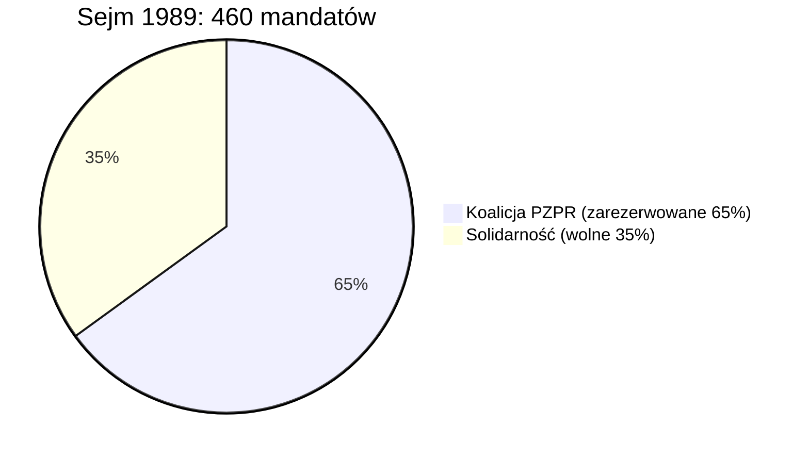
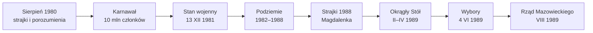

# 3. Ruch Solidarności (1980–1989)

> AQA A-level Polish 7687 · Research project *Polska w czasach komunizmu* · punkt 3 z 3: **ruch Solidarności**

## W skrócie: 5 tez do wypracowania

1. **NSZZ „Solidarność”** (wrzesień 1980) był pierwszym niezależnym związkiem zawodowym w bloku sowieckim i ruchem społecznym liczącym ok. 9,5–10 mln członków, czyli mniej więcej co trzeciego dorosłego Polaka.
2. **Wyrósł z czterech źródeł naraz**: buntów robotników, zorganizowanej opozycji (KOR, WZZ), Kościoła i papieża oraz kryzysu gospodarczego.
3. **Był pokojowy**: strajk okupacyjny zamiast walk ulicznych, zasada „bez przemocy”, msze w stoczni.
4. **Stan wojenny go nie zniszczył**: związek przetrwał w podziemiu, a idea wolności w ludziach.
5. **Doprowadził do Okrągłego Stołu, wyborów 4 czerwca 1989 r. i rządu Mazowieckiego**, otwierając Jesień Ludów w Europie Środkowej.

## Geneza: fale protestów przed 1980

| Rok | Wydarzenie | Lekcja dla opozycji |
| --- | --- | --- |
| 1956 | Poznański Czerwiec, hasło „chleba i wolności”, ok. 58 zabitych | robotnicy potrafią się zbuntować, ale władza strzela |
| 1968 | Marzec: protesty studentów po zdjęciu *Dziadów*, antysemicka nagonka, emigracja ok. 13 tys. osób | inteligencja sama przegrywa: robotnicy nie poparli studentów |
| 1970 | Grudzień na Wybrzeżu: podwyżki cen przed świętami, 45 zabitych i 1165 rannych; Gomułkę zastępuje Gierek | wyjście na ulicę kończy się śmiercią, lepszy jest strajk okupacyjny w zakładzie |
| 1976 | Czerwiec: Radom, Ursus, Płock; podwyżki cofnięte, ale robotników bito („ścieżki zdrowia”) i zwalniano | potrzebna jest organizacja, która obroni represjonowanych |

## Opozycja zorganizowana (1976–1980)

| Organizacja | Rok | Kto i co |
| --- | --- | --- |
| KOR (Komitet Obrony Robotników) | 23 IX 1976 | Jacek Kuroń, Jan Józef Lipski, Antoni Macierewicz, Adam Michnik i inni; pomoc prawna i finansowa dla robotników z Radomia i Ursusa, pismo *Robotnik* |
| ROPCiO | 1977 | obrona praw człowieka i obywatela |
| NOWa i drugi obieg | 1977 | niezależne książki i pisma poza cenzurą |
| Wolne Związki Zawodowe Wybrzeża | 1978 | Bogdan Borusewicz, Andrzej Gwiazda, Anna Walentynowicz, Lech Wałęsa: szkolenia o prawach pracowniczych |
| KPN | 1979 | Leszek Moczulski; partia otwarcie niepodległościowa |
| Uniwersytet Latający | od 1977 | prywatne wykłady z historii i literatury, której nie było w szkole |

Hasło Kuronia: „Nie palcie komitetów, zakładajcie własne”. Zamiast walczyć z państwem na ulicy, opozycja budowała niezależne społeczeństwo obywatelskie.

## Sierpień 1980 dzień po dniu

| Data | Wydarzenie |
| --- | --- |
| 1 lipca | podwyżki cen mięsa i wędlin; strajki w całym kraju, m.in. „lubelski lipiec” |
| 7 sierpnia | zwolnienie suwnicowej Anny Walentynowicz, kilka miesięcy przed emeryturą |
| 14 sierpnia | strajk w Stoczni Gdańskiej im. Lenina; na czele staje elektryk Lech Wałęsa |
| 16 sierpnia | dyrekcja spełnia żądania stoczni, ale Anna Walentynowicz, Alina Pienkowska i Henryka Krzywonos namawiają ludzi do strajku solidarnościowego z innymi zakładami |
| noc 16/17 sierpnia | powstaje MKS (Międzyzakładowy Komitet Strajkowy); do końca sierpnia uznało go ok. 700 zakładów |
| 17–18 sierpnia | 21 postulatów spisanych na tablicach i zawieszonych na bramie nr 2; msza polowa w stoczni |
| 18 sierpnia | strajk i MKS w Szczecinie (36 postulatów) |
| 22–23 sierpnia | przyjeżdżają eksperci (Tadeusz Mazowiecki, Bronisław Geremek); rozmowy z komisją rządową |
| 30 sierpnia | porozumienie w Szczecinie |
| 31 sierpnia | porozumienie w Gdańsku: Wałęsa i wicepremier Mieczysław Jagielski, transmisja w telewizji |
| 3 września | porozumienie w Jastrzębiu (górnicy, m.in. wolne soboty) |
| 6 września | Gierka zastępuje Stanisław Kania |

## 21 postulatów MKS

Od 2003 r. tablice z postulatami są na liście UNESCO Pamięć Świata.

| Rodzaj | Przykłady |
| --- | --- |
| polityczne | nr 1: wolne związki zawodowe niezależne od partii i pracodawców; prawo do strajku; wolność słowa i ograniczenie cenzury; uwolnienie więźniów politycznych; przywrócenie do pracy zwolnionych w 1970 i 1976 r.; dostęp Kościoła do radia; prawdziwa informacja o gospodarce |
| ekonomiczne i socjalne | podwyżki płac; zapłata za czas strajku; zaopatrzenie sklepów; kartki na mięso (nr 11); likwidacja sprzedaży za dewizy w kraju; zniesienie przywilejów MO, SB i aparatu partyjnego; krótsze czekanie na mieszkanie; żłobki i przedszkola; dłuższy urlop macierzyński; niższy wiek emerytalny; wolne soboty (nr 21) |

**Dlaczego w 1980 r. się udało?** Strajk okupacyjny zamiast demonstracji, zakaz alkoholu, dyscyplina, msze w stoczni, wsparcie ekspertów i Kościoła, jedność wielu zakładów, a także pamięć ofiar Grudnia 1970. Cena kompromisu: Solidarność uznała kierowniczą rolę PZPR i sojusze Polski.

## „Karnawał Solidarności” (sierpień 1980 – grudzień 1981)

| Data | Wydarzenie |
| --- | --- |
| 17 IX 1980 | jeden ogólnopolski związek; nazwę „Solidarność” zaproponował Karol Modzelewski; przewodniczący Lech Wałęsa |
| 10 XI 1980 | rejestracja przez Sąd Najwyższy, po sporze o zapis o kierowniczej roli PZPR |
| 16 XII 1980 | odsłonięcie pomnika Poległych Stoczniowców 1970 w Gdańsku |
| II 1981 | rejestracja Niezależnego Zrzeszenia Studentów (NZS) po strajku w Łodzi |
| 19 III 1981 | kryzys bydgoski: pobicie działaczy (m.in. Jana Rulewskiego) |
| 27 III 1981 | 4-godzinny strajk ostrzegawczy, największy strajk w historii bloku |
| V 1981 | rejestracja Solidarności Rolników Indywidualnych |
| IX–X 1981 | I Krajowy Zjazd Delegatów w Gdańsku: program „Samorządna Rzeczpospolita” i *Posłanie do ludzi pracy Europy Wschodniej*, które rozwścieczyło Moskwę |
| 18 X 1981 | gen. Wojciech Jaruzelski I sekretarzem PZPR (był już premierem) |

**Charakter ruchu:** związek zawodowy, ruch społeczny i ruch narodowy jednocześnie. Socjolożka Jadwiga Staniszkis nazwała to „samoograniczającą się rewolucją”: Solidarność nie żądała władzy, by nie sprowokować interwencji ZSRR. Do związku wstąpił też ok. milion członków PZPR, a cała partia liczyła ok. 3 mln.

**Symbole:** logo zaprojektowane przez Jerzego Janiszewskiego (litery jak tłum ludzi z flagą), krzyże pomnika stoczniowców, brama nr 2, *Tygodnik Solidarność* (red. Tadeusz Mazowiecki).

## Stan wojenny (13 grudnia 1981 – 22 lipca 1983)

- **Noc z 12 na 13 grudnia**: Wojskowa Rada Ocalenia Narodowego (WRON) z gen. Jaruzelskim wprowadza stan wojenny, niezgodnie z ówczesną konstytucją (trwała sesja Sejmu). Akcja internowania miała kryptonim „Jodła”.
- **Represje**: ok. 10 tys. internowanych (IPN: 9736), w tym większość władz związku i Wałęsa; tysiące skazanych i zwolnionych z pracy.
- **Pacyfikacje strajków**: 16 grudnia w kopalni „Wujek” w Katowicach pluton specjalny ZOMO zastrzelił 9 górników; w kopalni „Piast” górnicy strajkowali pod ziemią do 28 grudnia.
- **Kolejne ofiary**: 31 sierpnia 1982 r. w Lubinie milicja zastrzeliła demonstrantów; w maju 1983 r. milicjanci śmiertelnie pobili maturzystę Grzegorza Przemyka. Historycy szacują ofiary lat 80. na ok. 100 osób.
- **8 października 1982**: delegalizacja Solidarności; władza tworzy własne związki (OPZZ).
- **Wałęsa** internowany do listopada 1982 r.; w 1983 r. Pokojowa Nagroda Nobla (odebrała ją żona Danuta).
- **Spór o ocenę**: Jaruzelski twierdził, że wybrał „mniejsze zło” zamiast sowieckiej interwencji; IPN i sąd uznały stan wojenny za bezprawny.

**Reakcja świata:** sankcje USA, w Wigilię 1981 r. świeczki w oknach na znak solidarności z Polakami, paczki z Zachodu, rosnące poparcie dla Wałęsy; Jan Paweł II publicznie bronił prawa do wolnych związków.

## Podziemie (1982–1988)

- **Tymczasowa Komisja Koordynacyjna (TKK)**: Zbigniew Bujak, Władysław Frasyniuk, Bogdan Lis i inni kierowali związkiem w konspiracji.
- Setki podziemnych pism (np. *Tygodnik Mazowsze*), Radio Solidarność, książki, kasety i znaczki drugiego obiegu.
- Demonstracje w rocznice (31 sierpnia, 3 maja, 13 grudnia), msze za Ojczyznę.
- **Bierny opór**: bojkot telewizji („Telewizja kłamie”), spacery w Świdniku w czasie *Dziennika Telewizyjnego*.
- 1984: zabójstwo ks. Jerzego Popiełuszki; 1986: amnestia dla więźniów politycznych.

## Droga do 1989

1. **1985**: Michaił Gorbaczow (pieriestrojka, głasnost); ZSRR nie chce już interweniować.
2. **1987**: władza przegrywa referendum o reformach; gospodarka w zapaści.
3. **1988**: dwie fale strajków młodych robotników (kwiecień–maj i sierpień), żądanie: „Nie ma wolności bez Solidarności”.
4. **31 VIII 1988**: spotkanie Wałęsy z gen. Czesławem Kiszczakiem; **IX 1988**: poufne rozmowy w Magdalence z udziałem przedstawicieli Kościoła.
5. **30 XI 1988**: telewizyjna debata Wałęsy z szefem OPZZ Alfredem Miodowiczem; Wałęsa wygrywa ją w oczach widzów.
6. **XII 1988**: powstaje Komitet Obywatelski przy Lechu Wałęsie.
7. **Okrągły Stół (6 II – 5 IV 1989)**: trzy główne „stoliki” (polityczny, gospodarczy, związkowy). Ustalenia: ponowna legalizacja Solidarności (17 IV 1989), wybory „kontraktowe” (35% Sejmu i cały nowy Senat w wolnym głosowaniu), urząd prezydenta, niezależna prasa (*Gazeta Wyborcza* od 8 maja 1989 r.).

## Wybory 4 czerwca 1989

**Solidarność zdobyła 161 ze 161 wolnych mandatów w Sejmie i 99 ze 100 w Senacie.** Frekwencja w pierwszej turze: ok. 62%. Przepadła prawie cała „lista krajowa” znanych działaczy władzy.

| Izba | Ugrupowanie | Mandaty |
| --- | --- | --- |
| Sejm | PZPR | 173 |
| Sejm | ZSL | 76 |
| Sejm | SD | 27 |
| Sejm | PAX, UChS, PZKS | 23 |
| Sejm | **Solidarność** | **161** |
| Senat | **Solidarność** | **99** |
| Senat | kandydat niezależny | 1 |

## Od wyborów do końca PRL

- **Lipiec 1989**: Zgromadzenie Narodowe wybiera gen. Jaruzelskiego na prezydenta przewagą jednego głosu; Adam Michnik pisze artykuł „Wasz prezydent, nasz premier”.
- **24 sierpnia 1989**: Tadeusz Mazowiecki premierem, pierwszy niekomunistyczny szef rządu w bloku od lat 40. Możliwe, bo ZSL i SD przeszły na stronę Solidarności.
- **29 grudnia 1989**: nazwa Rzeczpospolita Polska i orzeł w koronie; **1 stycznia 1990**: plan Balcerowicza; **styczeń 1990**: rozwiązanie PZPR.
- **Grudzień 1990**: Lech Wałęsa prezydentem w wolnych wyborach; **1991**: pierwsze w pełni wolne wybory do Sejmu.
- **Jesień Ludów**: po Polsce upadają systemy w NRD (mur berliński, 9 listopada 1989), Czechosłowacji, na Węgrzech, w Bułgarii i Rumunii.

## Znaczenie Solidarności

- **Dla Polski**: pokojowe odzyskanie suwerenności i demokracji, bez wojny domowej.
- **Dla świata**: dowód, że masowy ruch bez przemocy może pokonać dyktaturę; Polska jako pierwsza wyłamała się z bloku sowieckiego.
- **Pamięć**: 31 sierpnia to Dzień Solidarności i Wolności; w Gdańsku działa Europejskie Centrum Solidarności (od 2014 r.).

## Ocena: czy bez Okrągłego Stołu nie byłoby wolnej Polski? (pytanie z 2024 r.)

| Okrągły Stół był kluczowy | Okrągły Stół to tylko jeden z czynników |
| --- | --- |
| pokojowe przekazanie władzy, bez rozlewu krwi | bez 10 mln ludzi w 1980–1981 i podziemia nie byłoby partnera do rozmów |
| dał wybory 4 czerwca i rząd Mazowieckiego | do rozmów zmusiły władzę kryzys, strajki 1988 i polityka Gorbaczowa |
| wzór dla innych krajów bloku (np. Węgier) | Kościół i papież od lat budowali odwagę i wspólne wartości |
| kompromis zapewnił stabilną zmianę | krytycy: układ z komunistami, brak rozliczeń („gruba linia” Mazowieckiego), uwłaszczenie nomenklatury |

## Kluczowe postacie

| Osoba | Rola |
| --- | --- |
| Lech Wałęsa | przywódca strajku i związku, Nobel 1983, prezydent 1990–1995 |
| Anna Walentynowicz | suwnicowa z WZZ; jej zwolnienie wywołało strajk |
| Alina Pienkowska, Henryka Krzywonos | 16 sierpnia 1980 r. przekonały ludzi do strajku solidarnościowego |
| Jacek Kuroń, Adam Michnik | KOR, doradcy, uczestnicy Okrągłego Stołu |
| Tadeusz Mazowiecki, Bronisław Geremek | eksperci strajku, architekci rozmów 1989; Mazowiecki premierem |
| Zbigniew Bujak, Władysław Frasyniuk | przywódcy podziemia (TKK) |
| ks. Jerzy Popiełuszko | kapelan Solidarności, zamordowany przez SB w 1984 r. |
| gen. Wojciech Jaruzelski | stan wojenny, potem zgoda na rozmowy; prezydent 1989–1990 |
| gen. Czesław Kiszczak | szef MSW, partner rozmów w Magdalence |

## Słownictwo

| Polski | English |
| --- | --- |
| niezależny samorządny związek zawodowy | independent self-governing trade union |
| strajk okupacyjny / solidarnościowy / ostrzegawczy | sit-in / sympathy / warning strike |
| postulat, porozumienie | demand, agreement |
| stan wojenny, internowanie, godzina milicyjna | martial law, internment, curfew |
| zdelegalizować / ponownie zalegalizować | to outlaw / to re-legalise |
| podziemie, konspiracja | the underground, clandestine activity |
| obrady Okrągłego Stołu, wybory kontraktowe | Round Table talks, semi-free elections |
| pokojowa rewolucja, Jesień Ludów | peaceful revolution, Autumn of Nations |

## Pytania egzaminacyjne i plan

1. Przeanalizuj, które osoby i wydarzenia wpłynęły na powstanie Solidarności i upadek systemu (pytanie z 2020 r.).
2. „Bez Okrągłego Stołu nie byłoby wolnej Polski.” Do jakiego stopnia się zgadzasz? (2024)
3. Oceń, czy stan wojenny osiągnął cel, jakim było zniszczenie Solidarności.

**Przykładowy akapit (AO2 + AO4):**

> Jak wynika z tekstu, Jacek Kuroń uczył robotników, że zamiast niszczyć cudze instytucje, trzeba budować własne. Moje badania potwierdzają, że to doświadczenie KOR i Wolnych Związków Zawodowych pozwoliło w sierpniu 1980 r. zorganizować strajk okupacyjny zamiast krwawych zamieszek z 1970 r. Z drugiej strony bez podwyżek cen mięsa i kryzysu gospodarczego protest nie objąłby 700 zakładów. Solidarność była więc owocem zarówno długiej pracy opozycji, jak i nagłego kryzysu.

**Pułapka:** nie opowiadaj samej historii od 1980 do 1989 r. Każdy akapit musi odpowiadać na pytanie i kończyć się oceną.

**Plan do pytania 3:** teza (krótko tak, długo nie) → internowania, delegalizacja, „Wujek”, strach i emigracja → podziemie, prasa, Nobel, Kościół → kontrargument: lata 1982–1988 to zmęczenie i słabość związku → wniosek: w 1989 r. władza musiała rozmawiać z Solidarnością, więc cel nie został osiągnięty.

## Daty do zapamiętania

1956 Poznań · 1970 Grudzień · 1976 Radom, KOR · 1978 WZZ · 14 VIII 1980 strajk · 31 VIII 1980 porozumienie · 10 XI 1980 rejestracja · 13 XII 1981 stan wojenny · 16 XII 1981 „Wujek” · 8 X 1982 delegalizacja · 1983 Nobel · 1988 strajki · 6 II – 5 IV 1989 Okrągły Stół · 4 VI 1989 wybory · 24 VIII 1989 Mazowiecki
